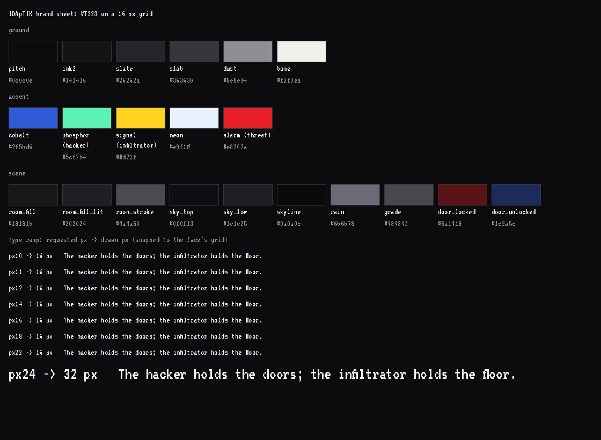
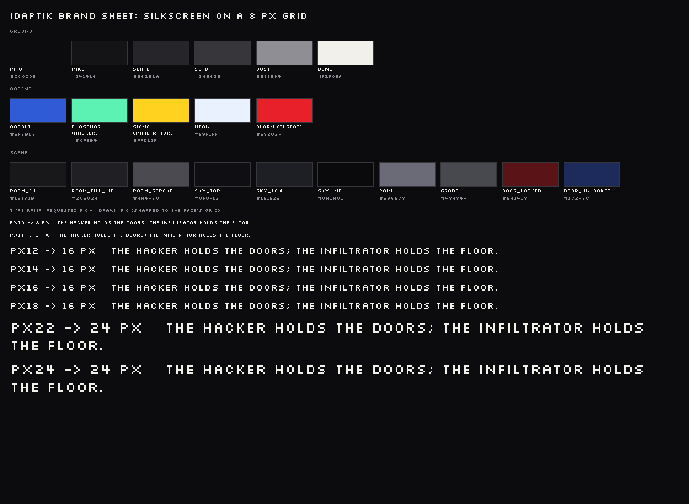
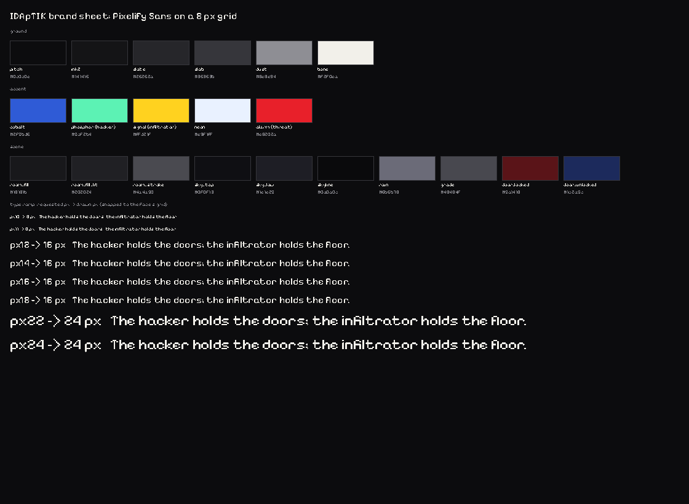

<!-- SPDX-FileCopyrightText: 2026 IDApTIK contributors -->
<!-- SPDX-License-Identifier: CC-BY-SA-4.0 -->

# IDApTIK brand book

The IDApTIK and Moletaire names and marks are trademarks (see `LICENSE` and
the deed); this book is CC-BY-SA-4.0 like the rest of the content layer.

**Where the values come from.** Every colour, typeface, size and spacing in
this book is held in one file, `config/brand-tokens.ncl`, typechecked by
`config/brand-schema.ncl`, exported to `crates/idaptik-brand/tokens.json` and
rendered into `crates/idaptik-brand/src/generated.rs`. The Bevy palette
(`crates/idaptik-bevy/src/palette.rs`) is a view over those constants. The
values were lifted verbatim on 2026-10-27 from the code that already drew the
game; no colour was invented and nothing was redrawn. `just brand-check`
proves the four files agree; `just brand-regen` rewrites the two generated
ones after an edit to the Nickel.

**What this book is not.** The handoff asked for a brand derived from source
material (a Gemini chat, a Canva export) that was never supplied, so this is
the brand *as built*. `inventory.md` lists everything still missing, and
nothing in it was reconstructed from memory.

## 1. Direction

Stated for the brand: **8/16-bit, post-wall industrial**, arranged like
**Neue Deutsche Welle**. Stated by the palette that draws the game, which is
the same thing seen from the screen:

> The look is early-1980s new wave: a cold, minimal ground of off-black,
> concrete grey and off-white, and a few hard flat accents — signal red,
> signal yellow, cobalt, acid mint — never soft, never many at once.

The two agree on every point that reaches a pixel: a near-monochrome concrete
ground, hard flat accents that mean something, pixel type on a grid, no
anti-aliasing, no rounded corners, no gradients except the night sky. Where
they might diverge (motion, sound, copy voice) there is no source yet, so this
book stays silent rather than guessing.

The game is asymmetric. The **infiltrator** plays a side-scrolling floor; the
**hacker** plays a deck of screens over a van. One palette serves both, by the
seat law below: the floor is concrete and night with the infiltrator's yellow
on what is theirs; the deck is night with phosphor on everything wireable. A
reader can tell whose UI they are looking at from the accent alone.

## 2. Colour

### 2.1 The palette

| Token | Hex | Group | Seat | Use |
|---|---|---|---|---|
| `pitch` | `#0c0c0e` | ground | — | Base night; interiors unlit. Off-black, not blue. The window clear colour. |
| `ink2` | `#141416` | ground | — | Second ink: the floor tile's seam line and the building's shell. |
| `slate` | `#26262a` | ground | — | Concrete, road, structure. The meter track. |
| `slab` | `#36363b` | ground | — | Door frames, props, the roof slab, the overlay panel's border. |
| `dust` | `#8e8e94` | ground | — | Key hints, the isolation meter, edges and trims on concrete; dead view cones. |
| `bone` | `#f2f0ea` | ground | — | Paper, type, fiche. The HUD's text colour. |
| `cobalt` | `#2f5bd6` | accent | — | Cobalt: civic, open, safe passage. The bandwidth meter and cable trays. |
| `phosphor` | `#5cf2b4` | accent | hacker | The hacker's seat. Screens only: wiring labels and anything wireable. |
| `signal` | `#ffd21f` | accent | infiltrator | Signal yellow: the infiltrator's seat, trim, and anything theirs. |
| `neon` | `#e9f1ff` | accent | — | Cold fluorescent light: room light, windows, street lamps. The trace meter and the end-of-run overlay text. |
| `alarm` | `#e8202a` | accent | threat | Signal red: threat, alarm, the Machine. Camera LEDs and the crisis wash. |
| `room_fill` | `#18181b` | scene | — | Room interior, lights off. |
| `room_fill_lit` | `#202024` | scene | — | Room interior, lights on. |
| `room_stroke` | `#4a4a50` | scene | — | The room's stroke. |
| `sky_top` | `#0f0f13` | scene | — | Sky gradient, top. |
| `sky_low` | `#1e1e25` | scene | — | Sky gradient, horizon. |
| `skyline` | `#0a0a0c` | scene | — | The skyline silhouette. |
| `rain` | `#6b6b78` | scene | — | Rain streaks. |
| `grade` | `#48484f` | scene | — | Ground grade line. |
| `door_locked` | `#5a1418` | scene | — | Door slab fill when locked by a wire (the bible's oxblood). |
| `door_unlocked` | `#1c2a5c` | scene | — | Door slab fill when unlocked (the bible's verdigris, in this palette's cobalt family). |

In code: `idaptik_brand::generated::colour::PITCH` (a `u32`, `0x0c0c0e`) and
`idaptik_bevy::palette::PITCH` (a Bevy `Color`). The brand sheet
(`brand-sheet-vt323.png` below) is these 21 swatches drawn by the frontend.

### 2.2 The seat law

Three accents carry meaning and nothing else may use them:

- **`phosphor` is the hacker's**, and it lives on screens. Wiring, ports,
  labels on the deck, the CRT in the van. It never appears on the floor as
  decoration.
- **`signal` is the infiltrator's.** Their trim, their fascia on the roof,
  anything that is theirs to touch.
- **`alarm` is threat and the Machine.** Camera LEDs, the crisis wash over the
  floor, the locked door's oxblood is its dark relative.

`cobalt` and `neon` are the world's: civic passage and cold light. `bone` is
type. The greys are structure.

Do:

- Put one accent on a surface, on a ground of `pitch`/`slate`/`slab`.
- Let a screen be `pitch` with `phosphor` on it and nothing else.
- Let the HUD be `bone` on `pitch`, hints in `dust`.

Don't:

- Mix two accents on one element.
- Use `alarm` as body text (it fails 4.5:1 on night, see §5).
- Tint, soften, gradient or shadow an accent. Accents are flat.
- Introduce a colour by writing a hex in Rust. Add a token, regenerate, then
  use it. The inventory lists the literals that predate this rule.

### 2.3 Worked examples

The HUD status line is `bone` type on the `pitch` clear colour, with meters as
`cobalt`/`dust`/`neon` bars on a `slate` track: three accents, each alone on
its own bar, none touching another (`hud.rs`). A locked door is a
`door_locked` slab in a `slab` frame; when the hacker unlocks it the slab
turns `door_unlocked`, the cobalt family saying "passage" without a word. The
hacker's wiring view is `phosphor` labels at `px10` on a `pitch` screen
(`wiring.rs`), and the only other colour that may appear there is `alarm` on
a camera that is watching.

## 3. Type

### 3.1 The faces

Three pixel faces are bundled (`crates/idaptik-bevy/assets/fonts/`), each
under the SIL Open Font License 1.1 with the licence text beside it. One is
installed as Bevy's default font at startup (`fonts::install_ui_font`), so
every text in the game uses it without naming it.

| Token | Family | File | Grid | Role |
|---|---|---|---|---|
| `vt323` | VT323 | `VT323-Regular.ttf` | 16 px | **Default.** A terminal face. |
| `silkscreen` | Silkscreen | `Silkscreen-Regular.ttf` | 8 px | Blocky capitals; `IDAPTIK_UI_FONT=silkscreen`. |
| `pixelify` | Pixelify Sans | `PixelifySans.ttf` | 8 px | A readable pixel sans; `IDAPTIK_UI_FONT=pixelify`. |

Rules the code enforces (`fonts::crisp_text`): **no anti-aliasing**, and
every size is **snapped to a whole multiple of the face's grid**, never below
one grid. Type is pixels or it is not IDApTIK.

### 3.2 The ramp

The code requests eight sizes (`size.*`); the face decides what is drawn.

| Token | Requested | Drawn, VT323 (16 px grid) | Drawn, Silkscreen / Pixelify (8 px grid) | Where |
|---|---|---|---|---|
| `px10` | 10 | 16 | 8 | Wire port labels; console sign text. |
| `px11` | 11 | 16 | 8 | Key hints; net-view device labels. |
| `px12` | 12 | 16 | 16 | Body copy: wiring help, net HUD, role-select body. |
| `px14` | 14 | 16 | 16 | Netplay status line. |
| `px16` | 16 | 16 | 16 | Deck cards, CRT console text, role-select labels. |
| `px18` | 18 | 16 | 16 | Role-select subtitle. |
| `px22` | 22 | 16 | 24 | End-of-run overlay. |
| `px24` | 24 | 32 | 24 | Role-select title. |

Read the VT323 column: in the default face the ramp is effectively **two
steps, 16 and 32 px**. That is a finding, not a rule (inventory, "the type
ramp collapses"); it is recorded here so a designer sees what the player sees.
The brand sheets render the ramp in each face so the table can be checked by
eye.

## 4. Space, radius, grid

| Token | px | Where |
|---|---|---|
| `hairline` | 1 | Deck card border. |
| `rule` | 2 | Overlay panel border; tight row gap inside a deck card. |
| `gap_4` | 4 | HUD row gap. |
| `gap_6` | 6 | HUD column gap; deck card row gap. |
| `inset_8` | 8 | HUD top inset; deck card padding. |
| `inset_10` | 10 | HUD side inset; deck panel padding; meter bar height. |
| `pad_16` | 16 | Overlay panel vertical padding. |
| `gap_18` | 18 | Deck panel column gap. |
| `pad_28` | 28 | Overlay panel horizontal padding. |
| `log_bottom` | 46 | The log tail's offset from the bottom edge. |
| `meter_label` | 70 | Meter label column width. |
| `meter_bar` | 180 | Meter bar width. |

Radius: `corner` = **0**. Nothing is rounded; Bevy's `BorderRadius` is never
set in the frontend.

The art grid: the floor camera draws **3 screen pixels per art pixel**
(`grid.screen_px_per_art_px`); the infiltrator is **48 art pixels** tall for
**54 canvas units** (`grid.figure_art_px`, `grid.figure_units`), nearest
sampled. A new sprite drawn at that density drops in.

## 5. Legibility (what passes, what fails)

The rule from the handoff: text contrast at 4.5:1, 3:1 for large text and UI
glyphs, checked in every palette, **failures flagged, never silently changed**.
The verdicts below are decided exactly, in integers, by
`idaptik_kernel::contrast` (the proof kernel; its two functions carry Creusot
contracts) over channels linearised in `idaptik_brand::srgb`, and every row is
pinned by `crates/idaptik-brand/tests/legibility.rs`. Change the palette and
the test tells you which row moved.

| Foreground on background | Ratio | Text (4.5:1) | Glyph (3:1) | Drawn today as |
|---|---|---|---|---|
| `bone` on `pitch` | 17.15 | pass | pass | HUD status, meters, log |
| `neon` on `pitch` | 17.21 | pass | pass | end-of-run overlay text |
| `phosphor` on `pitch` | 13.79 | pass | pass | wiring labels, help line |
| `signal` on `pitch` | 13.48 | pass | pass | the infiltrator's labels |
| `dust` on `pitch` | 6.00 | pass | pass | key hints |
| `bone` on `slate` | 13.23 | pass | pass | meter label on its track |
| `bone` on `slab` | 10.54 | pass | pass | type on a frame or prop |
| `bone` on `room_fill` / `room_fill_lit` | 15.55 / 14.25 | pass | pass | type over a room |
| `phosphor` on `room_fill` | 12.50 | pass | pass | a screen inside a room |
| `dust` on `slate` | 4.63 | pass | pass | isolation meter bar |
| **`alarm` on `pitch`** | **4.35** | **fail** | pass | never as text; LEDs and wash only |
| **`dust` on `slab`** | **3.69** | **fail** | pass | not drawn; recorded so nobody starts |
| **`cobalt` on `pitch`** | **3.34** | **fail** | pass | bandwidth bar (a glyph, fine) |
| `rain` on `pitch` | 3.72 | fail | pass | a surface, not text |
| `slab` on `pitch` | 1.63 | fail | fail | a surface, not text |
| `room_stroke` on `pitch` | 2.22 | fail | fail | a surface, not text |

Three flags, none of them a change: alarm red, dust-on-slab and cobalt are
glyph colours, not text colours, and the game draws them as glyphs. The rule
for a new text site is one line: **type is `bone`, `neon`, `phosphor`,
`signal` or `dust`, on `pitch`, `slate`, `slab` or a room fill.**

## 6. The pixel-art palette

The sprites README speaks of a shared 38-colour palette. Measured over the
embedded PNGs on 2026-10-27: **36** distinct opaque colours across the 57
sprites, **30** across the 29 backdrop pieces, and both sets contain `pitch`,
`slate`, `slab`, `room_stroke`, `cobalt`, `alarm` and `neon` verbatim, which
is what makes the UI palette and the art one palette. Committing that set as
a `.gpl` with a gate is an open item (inventory); until then the sprites
themselves are the palette, and `assets/sprites/README.md` describes how they
were cut.

## 7. Changing the brand

1. Edit `config/brand-tokens.ncl`. A wrong hex, a duplicate name or a theme
   that drifts from its value fails the typecheck
   (`config/brand-fixtures/bad_*.ncl` are the proofs that it can fail).
2. `just brand-regen` rewrites `tokens.json` (I-JSON, JCS bytes, one trailing
   LF) and `generated.rs`.
3. `just brand-check` (also run by `just config-check` and, through
   `test-ghost`, by CI) re-exports, re-renders, compares, and re-runs the
   legibility verdicts. If a verdict moved, update §5 and the test together.
4. `just brand-sheet` to look at it; `--screenshot PATH` to refresh the
   images below.

## 8. The sheets

Rendered by `crates/idaptik-bevy/examples/brand_sheet.rs` from the generated
constants (nothing is typed into the example), one per bundled face:

| | |
|---|---|
|  | `brand-sheet-vt323.png`, the default face |
|  | `brand-sheet-silkscreen.png` |
|  | `brand-sheet-pixelify.png` |

Regenerate with:

```sh
for f in vt323 silkscreen pixelify; do
  IDAPTIK_UI_FONT=$f just brand-sheet --screenshot docs/design/brand/brand-sheet-$f.png
done
```

(headless: prefix with `WGPU_BACKEND=vulkan xvfb-run -a`, which is how the
committed ones were made, on Mesa's lavapipe).
